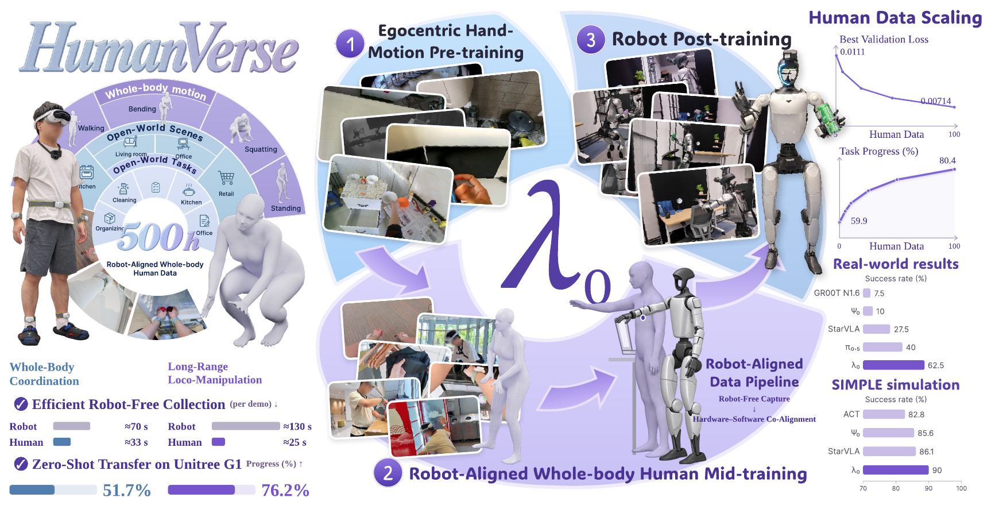
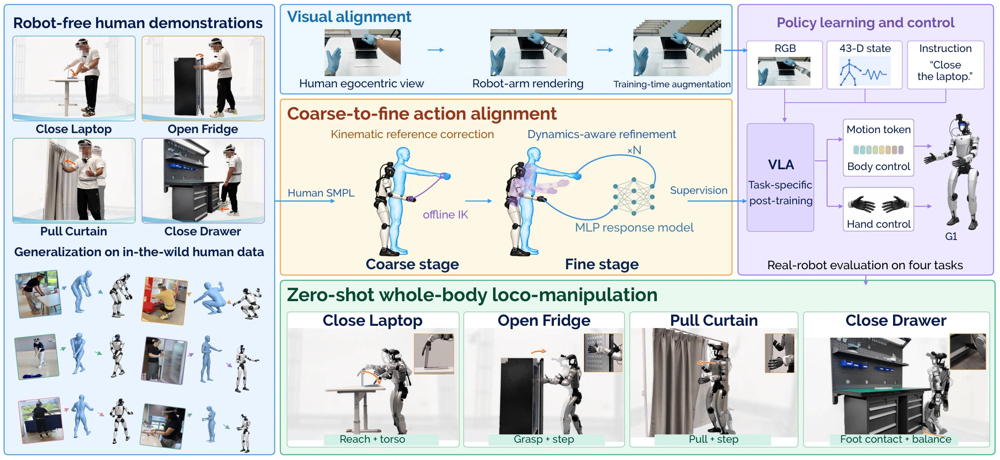
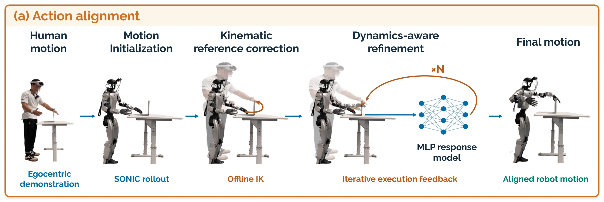

<p align="center">
  <a href="https://github.com/LambdaHumanoid">
    
  </a>
</p>

<h1 align="center">Openlambda for Generalist Humanoid Learning</h1>

<p align="center">
  <a href="https://arxiv.org/abs/2610.18950"></a>
  <a href="https://lambdahumanoid.github.io/"></a>
  <a href="https://huggingface.co/papers/2610.18950"></a>
  <a href="https://lambdahumanoid.github.io/#report-video"></a>
  <br>
  <a href="https://huggingface.co/lambda-humanoid/lambda0-midtrain-100k"></a>
  <a href="https://huggingface.co/datasets/lambda-humanoid/HumanVerse-500-sample"></a>
  <a href="LICENSE"></a>
  
</p>

<p align="center">
  <a href="#highlights">Highlights</a> ·
  <a href="#overview">Overview</a> ·
  <a href="#results">Results</a> ·
  <a href="#get-started">Get started</a> ·
  <a href="#hardware-setup">Hardware</a> ·
  <a href="#data-alignment">Alignment</a> ·
  <a href="#todo">TODO</a> ·
  <a href="#citation">Citation</a>
</p>

<a id="abstract"></a>
<div align="center">

*$\lambda_{\mathit{0}}$ learns whole-body humanoid loco-manipulation from everyday human experience.*

</div>

<p align="center"><a id="demo"></a>
  <a href="docs/assets/lambda0-demo.mp4">
    
  </a>
</p>

<a id="news"></a>

## News

- **`2026.10.27`** 🤖 Real-robot demonstration collection for Unitree G1 is released. See the [collection guide](data_collection/robot/README.md) ([中文教程](data_collection/robot/docs/tutorial.zh-CN.md)).
- **`2026.10.21`** 🤗 The λ₀ report is featured in [Hugging Face Daily Papers](https://huggingface.co/papers/2610.18950).
- **`2026.10.14`** 🚀 **openlambda** is open-sourced with λ₀ training code, human data collection, motion alignment and [alignment examples](https://github.com/LambdaHumanoid/openlambda/releases/tag/v0.1.1).
- **`2026.10.13`** 📄 The [λ₀ report](https://arxiv.org/abs/2610.18950) is on arXiv: from everyday human experience to humanoid intelligence. The shape of **λ** echoes **人**, the Chinese character for “human”.
- **`2026.09.30`** 📄 [Towards a General Humanoid Loco-Manipulation Model via Egocentric Whole-Body Human Data Pretraining](https://arxiv.org/abs/2610.00438) is on arXiv.
- **`2026.09.29`** 📄 [EgoHumanoid-V2](https://arxiv.org/abs/2609.37181) and [EgoAlign](https://arxiv.org/abs/2609.38046) are on arXiv.

<a id="highlights"></a>

## Highlights

- 🌍 **HumanVerse:** 500 hours of robot-free capture across open-world scenes and tasks, pairing egocentric video with synchronized whole-body and hand motion.
- 🔗 **Robot-aligned data pipeline:** human video and motion are aligned to the robot's camera view and action space ([details](#data-alignment)).
- ⚡ **Cheaper data:** about **3.4×** collection throughput compared with robot teleoperation across representative task families (≈29 s vs. ≈100 s per demonstration).
- 🤖 **Strong transfer on Unitree G1:** **62.5%** real-world success and **80.4%** task progress over four tasks, +22.5 and +25.8 points over the strongest external baseline.

<a id="overview"></a>

## Overview

<p align="center">
  <a href="https://lambdahumanoid.github.io/#overview">
    
  </a>
</p>

λ₀ couples a shared vision–language backbone with an action expert. It takes a robot camera image, a language instruction and proprioception, and outputs whole-body motion tokens executed by [SONIC](https://github.com/NVlabs/GR00T-WholeBodyControl) together with hand commands. Training runs in three stages:

| Stage | Data | Purpose |
| :--- | :--- | :--- |
| **I · Egocentric hand-motion pretraining** | Seven existing egocentric human datasets | Learn object interaction and articulated hand motion |
| **II · Robot-aligned whole-body human mid-training** | HumanVerse, aligned to the G1 observation and action spaces | Learn whole-body coordination from human experience |
| **III · Robot post-training** | 600 task-aligned human demonstrations (150 per task, held out from HumanVerse) plus native robot demonstrations | Ground the model in executable robot actions |

<details>
<summary><strong>Full pipeline figure</strong></summary>
<br>
<p align="center">
  
</p>
</details>

<a id="results"></a>

## Results

Real-world evaluation on Unitree G1 across four tasks (Close Laptop, Open Fridge, Pull Curtain, Close Drawer), 40 trials per method.

<table>
<tr>
<td width="50%" valign="top">

| Method | Success (%) | Progress (%) |
| :--- | ---: | ---: |
| GR00T N1.6 | 7.5 | 21.3 |
| Ψ₀ | 10.0 | 31.8 |
| StarVLA | 27.5 | 54.6 |
| π₀.₅ | 40.0 | 54.0 |
| **λ₀ (ours)** | **62.5** | **80.4** |

</td>
<td width="50%" valign="top">

| Training recipe | Success (%) | Progress (%) |
| :--- | ---: | ---: |
| No Stage I or II | 15.0 | 54.0 |
| Stages I + III | 22.5 | 59.9 |
| Stages II + III | 50.0 | 75.9 |
| **Full recipe (I + II + III)** | **62.5** | **80.4** |

</td>
</tr>
</table>

- **Simulation:** 90.0% success on SIMPLE (six core tasks, three difficulty levels, 180 trials).
- **Zero-shot transfer:** 76.2% progress on long-range loco-manipulation (EgoAlign) and 51.7% on whole-body loco-manipulation (EgoHumanoid-V2).
- **Data scaling:** with a fixed 2B model, going from 5% to 100% of the human data lowers the minimum validation loss by 35.5% on the representative holdout and 40.6% on the clean holdout.

See the [project page](https://lambdahumanoid.github.io/) and the [report](https://arxiv.org/abs/2610.18950) for the full evaluation.

<a id="releases"></a>

## Releases

| Resource | Description | Link |
| :--- | :--- | :--- |
| Stage II checkpoint | λ₀ after 100k mid-training updates, used to initialize the Stage III example | [🤗 lambda0-midtrain-100k](https://huggingface.co/lambda-humanoid/lambda0-midtrain-100k) |
| HumanVerse sample | A sample of the HumanVerse dataset (not the full 500 hours) | [🤗 HumanVerse-500-sample](https://huggingface.co/datasets/lambda-humanoid/HumanVerse-500-sample) |
| Alignment examples | Four trajectories with data, reports and replay videos | [examples](data_collection/human/data_alignment/examples) · [v0.1.1 release](https://github.com/LambdaHumanoid/openlambda/releases/tag/v0.1.1) |
| Hardware mounts | STL files for the G1–Revo2 adapters and the head-mounted GoPro bracket | [hardware/assets](data_collection/robot/hardware/assets) |

<a id="get-started"></a>

## Get started

```bash
git clone https://github.com/LambdaHumanoid/openlambda.git
cd openlambda
```

| Task | Guide |
| :--- | :--- |
| Train λ₀ | [Model setup](#lambda0-install) |
| Collect real-robot demonstrations | [G1 recorder and tutorial](data_collection/robot/README.md) |
| Collect human data | [Hardware](#human-data-collection-hardware) → [Environment](#human-collection-environment) → [Recording](#human-data-collection) |
| Align and replay motion | [Environment](#robot-runtime-environment) → [Alignment](#action-alignment) |

<a id="model-training"></a>

## λ₀ foundation model

<a id="lambda0-install"></a>
<a id="policy-environment"></a>

### Install and run λ₀

Requires Python 3.11 or 3.12. From the repository root:

```bash
PYTHON=python3.11 bash scripts/install.sh
source .venv/bin/activate
python scripts/test.py -v
```

`scripts/test.py` checks package installation and CLI compatibility.

Optional extras: `bash scripts/install.sh serve,tracking` enables HTTP inference and WandB; `fast` adds platform-dependent GPU kernels. Existing environments can still use `python -m pip install -e .` (or `.[serve]`, `.[tracking]`, `.[fast]`) from the repository root.

### Training

| Stage | Data selection | Training config |
| :--- | :--- | :--- |
| I · Pretraining | `configs/lambda0/pretrain/data.json` | `configs/lambda0/pretrain/train.json` |
| II · Mid-training | `configs/lambda0/midtrain/data.example.json` | `configs/lambda0/midtrain/train.json` |
| III · Post-training | `configs/lambda0/posttrain/data.example.json` | `configs/lambda0/posttrain/train.json` |

The Stage III example initializes from the raw weights in the [Stage II checkpoint](https://huggingface.co/lambda-humanoid/lambda0-midtrain-100k). Set `STAGE2_CHECKPOINT_DIR` to its downloaded directory.

From the repository root, set the paths required by the selected config, then prepare data and validate it (Stage I example). Relative paths in JSON configs resolve from the config file; command-line paths resolve from the current working directory:

```bash
python scripts/prepare.py --source-config configs/lambda0/pretrain/data.json \
  --data-root "$DATA_ROOT" --output "$BUNDLE_DIR"
python scripts/train.py --config configs/lambda0/pretrain/train.json --check-only
```

<details>
<summary><strong>Training data format</strong></summary>

Stage I expects first-person video and Parquet `observation.state` and `observation.valid_mask` fields, each with 138 coordinates per frame. Stage II and III examples expect canonical `observation.state`, `observation.valid_mask`, `action`, and `action.valid_mask` fields plus aligned video and metadata; the action and state dimensions follow the selected contract in `src/openlambda/models/action_specs.py`. Defaults are in `src/openlambda/recipes/`; editable examples are in `configs/lambda0/`.

Human collection outputs (`observation.pico.*`, `observation.images.gopro`) and alignment outputs (64-dimensional `action.motion_token`) require conversion before training. Stage II uses a 76-dimensional SONIC/Revo2 action contract, including hand commands. Conversion must supply aligned video, actions, proprioception, timestamps, task text, and validity masks. `lambda0 prepare` only bundles episodes already in the canonical format.

</details>

<a id="hardware-setup"></a>

## Hardware setup

<table width="100%">
<tr>
<td width="50%" valign="top">
<a id="human-data-collection-hardware"></a>
<h3>Human Hardware</h3>

<details>
<summary>🔴 <strong>PICO 4 Ultra</strong></summary>

- **Tracking:** [PICO 4 Ultra](https://www.picoxr.com/global/products/pico4-ultra) + trackers<br>for whole-body and hand tracking
- **Software:** XRobo&#8203;Toolkit<br>[Setup&nbsp;guide](https://github.com/NVlabs/GR00T-WholeBodyControl/blob/main/docs/source/getting_started/vr_teleop_setup.md#step-1-install-xrobotoolkit) · [Python&nbsp;SDK](https://github.com/XR-Robotics/XRoboToolkit-PC-Service-Pybind)
- **Connec&#8203;tion:** same LAN as the PC<br>enable Head, Hand and Send

</details>
<br>
<details>
<summary>🔵 <strong>5× PICO Trackers</strong></summary>

- **Placement:** five trackers<br>both wrists, waist and both ankles
- **Calibration:** PICO Motion Tracker<br>pair and calibrate in the app ([guide](https://github.com/NVlabs/GR00T-WholeBodyControl/blob/main/docs/source/getting_started/vr_teleop_setup.md#motion-tracker-calibration))
- **Mode:** Full Body in XRobo&#8203;Toolkit<br>enable Hand tracking ([setup&nbsp;guide](https://github.com/NVlabs/GR00T-WholeBodyControl/blob/main/docs/source/getting_started/vr_teleop_setup.md#step-4-connect-the-pico-to-your-workstation))

</details>
<br>
<details>
<summary>🟠 <strong>GoPro</strong></summary>

- **Mount:** neck-mounted bracket<br>Example: [JD listing](https://item.jd.com/product/5qVT4d95gaChewMJeYVDKQ.html)
- **Alignment:** match height, pitch and framing to the robot camera
- **Connec&#8203;tion:** Bluetooth pairing and WiFi setup;<br>WiFi / COHN recording and download ([API](https://github.com/gopro/OpenGoPro))

</details>
</td>
<td width="50%" valign="top">
<a id="robot-data-collection-hardware"></a>
<h3>Robot Hardware</h3>

<details>
<summary>🟢 <strong>Unitree G1</strong></summary>

- **Platform:** [Unitree G1](https://www.unitree.com/g1/), 29 body DOF<br>excluding hands ([joint&nbsp;layout](https://github.com/unitreerobotics/unitree_rl_gym/blob/main/resources/robots/g1_description/README.md))
- **Control:** [SONIC whole-body controller](https://github.com/NVlabs/GR00T-WholeBodyControl)<br>runs on an external Linux PC
- **Connec&#8203;tion:** wired or WiFi to the PC<br>via the ZMQ bridge

</details>
<br>
<details>
<summary>🔵 <strong>BrainCo Revo2</strong></summary>

- **Hand:** 6 active DOF per hand<br>11 including passive joints ([specs](https://brainco.tech/docs/revolimb-hand/en/revo2/parameters.html))
- **Software:** [official&nbsp;SDK](https://github.com/BrainCoTech/brainco-hand-sdk)<br>hand control and state feedback
- **Mount:** custom G1–Revo2 adapters<br>STL: [part 1](data_collection/robot/hardware/assets/Revo2-G1-1.stl) · [part 2](data_collection/robot/hardware/assets/Revo2-G1-2.stl)

</details>
<br>
<details>
<summary>🟠 <strong>GoPro</strong></summary>

- **Mount:** head-mounted bracket<br>STL: [part 1](data_collection/robot/hardware/assets/G1_GoPro_1.stl) · [part 2](data_collection/robot/hardware/assets/G1_GoPro_2.stl)
- **Alignment:** match height, pitch and framing to the human camera
- **Connec&#8203;tion:** USB control and video to robot;<br>wired / WiFi forwarding to host ([API](https://github.com/gopro/OpenGoPro))

</details>

</td>
</tr>
</table>

<a id="environment-setup"></a>

## Environment setup

Use separate environments for robot control, human collection, and [model training](#lambda0-install).

<a id="prerequisites"></a>

<a id="installation"></a>

<a id="robot-runtime-environment"></a>

<details>
<summary>🤖 <strong>Robot Control &amp; Data Collection</strong></summary>

### Host

Ubuntu 22.04 · NVIDIA driver **580+**.

**1. Install dependencies.**

```bash
sudo apt-get update
sudo apt-get install -y --no-install-recommends ca-certificates curl build-essential cmake git git-lfs libgl1 libegl1 libegl-mesa0 libglib2.0-0 ffmpeg libyaml-cpp-dev libeigen3-dev libmsgpack-dev libzmq3-dev nlohmann-json3-dev libssl-dev zlib1g-dev
curl -LsSf https://astral.sh/uv/0.11.14/install.sh | sh
source "$HOME/.local/bin/env"
curl -fL https://developer.download.nvidia.com/compute/cuda/repos/ubuntu2204/x86_64/cuda-keyring_1.1-1_all.deb -o /tmp/cuda-keyring.deb
sudo dpkg -i /tmp/cuda-keyring.deb
sudo apt-get update
sudo apt-get install -y --no-install-recommends cuda-minimal-build-12-4
```

**2. Install TensorRT and ONNX Runtime.** Download `TensorRT-10.13.3.9.Linux.x86_64-gnu.cuda-13.0.tar.gz` from [NVIDIA](https://developer.nvidia.com/tensorrt/download) to the repository root, then run:

```bash
sudo tar -xzf TensorRT-10.13.3.9.Linux.x86_64-gnu.cuda-13.0.tar.gz -C /opt
curl -fL https://github.com/microsoft/onnxruntime/releases/download/v1.16.3/onnxruntime-linux-x64-1.16.3.tgz -o /tmp/onnxruntime.tgz
sudo tar -xzf /tmp/onnxruntime.tgz -C /opt
```

**3. Install environment.** Repeat the exports when opening a new terminal.

```bash
export TensorRT_ROOT=/opt/TensorRT-10.13.3.9
export onnxruntime_ROOT=/opt/onnxruntime-linux-x64-1.16.3
export CUDAToolkit_ROOT=/usr/local/cuda-12.4
export LD_LIBRARY_PATH="$TensorRT_ROOT/lib:$onnxruntime_ROOT/lib:$CUDAToolkit_ROOT/lib64${LD_LIBRARY_PATH:+:$LD_LIBRARY_PATH}"
bash data_collection/robot/setup/install_host.sh
```

**4. Activate environment.**

```bash
source sonic/.venv/bin/activate
```

### Robot

ARM64 · Ubuntu 20.04 · ROS 2 Foxy · Python 3.8.

**1. Install environment.**

```bash
sudo apt-get update
sudo apt-get install -y python3-dev python3-venv build-essential cmake git python3-colcon-common-extensions ros-foxy-rmw-cyclonedds-cpp ros-foxy-rosidl-generator-dds-idl libyaml-cpp-dev libssl-dev libgl1 libglib2.0-0
bash data_collection/robot/setup/install_robot.sh
```

**2. Activate environment.**

```bash
source /opt/ros/foxy/setup.bash
source .venv-robot/ros_ws/install/setup.bash
source .venv-robot/bin/activate
```

</details>
<br>
<a id="human-collection-environment"></a>

<details>
<summary>👤 <strong>Human Data Collection</strong></summary>

<p>Ubuntu 22.04 · Python 3.10.</p>

**1. Install environment.**

```bash
sudo apt-get update
sudo apt-get install -y ca-certificates python3.10-dev python3.10-venv build-essential cmake git ffmpeg bluez network-manager
bash data_collection/human/setup/install.sh
```

**2. Activate environment.**

```bash
source .venv-human/bin/activate
```

</details>
<br>
<a id="data-collection"></a>

<a id="human-data-collection"></a>

## Human data collection

**1. Prepare devices.**

Connect the host and PICO headset to the same network. Start the XRoboToolkit PC service on the host and the XRoboToolkit app on the headset, then enable body and hand tracking. Turn on the GoPro, enable Bluetooth pairing and select Video mode; the collector connects it to the host's WiFi network in the next step.

**2. Start recording.**

```bash
lambda-collect-human --task-name "{task_name}" --task "{task_instruction}"
```

Open `http://127.0.0.1:8080`. Enter the host's WiFi credentials if needed, then click **Prepare collection → Start recording → Save episode / Discard episode**. Wait for saving before recording again. Episodes are saved in LeRobot format to `data/{task_name}/`; new recordings append to the dataset.

**3. Check and synchronize data.**

```bash
lambda-sync-human --root "data/{task_name}"
```

Synchronizes motion and video at 50 Hz. Output: `data/{task_name}_synced/`; synchronization and quality reports: `meta/`.

<a id="robot-data-collection"></a>

## Real-robot data collection

Record G1/SONIC/Revo2 demonstrations with a wired GoPro. Video, robot states
and hand targets are saved on G1 during teleoperation, then aligned and exported
as Parquet and MP4 on the workstation.

Follow the [collection guide](data_collection/robot/README.md) or
[中文教程](data_collection/robot/docs/tutorial.zh-CN.md) to record your first episode.
The [data format reference](data_collection/robot/docs/data-format.md) covers the
44D state and 76D action layout for training adapters.

<a id="data-processing"></a>
<a id="data-alignment"></a>

## Data alignment

<a id="action-alignment"></a>

<p align="center">
  
</p>

Four [example trajectories](data_collection/human/data_alignment/examples) and their [data, reports, and videos](https://github.com/LambdaHumanoid/openlambda/releases/tag/v0.1.1) are available. Each replay compares motion before (left) and after (right) alignment.

<table>
<tr>
<td width="50%">

https://github.com/user-attachments/assets/c4b43c5d-199a-447b-b0a3-afe6afe76d3e

</td>
<td width="50%">

https://github.com/user-attachments/assets/a7d8f8d4-a22a-40b6-816a-bf562f691720

</td>
</tr>
<tr>
<td width="50%">

https://github.com/user-attachments/assets/403659cc-2f87-4d60-bf84-14bf831a65d7

</td>
<td width="50%">

https://github.com/user-attachments/assets/71c1de99-8f2e-4ee1-875c-fe4be36db618

</td>
</tr>
</table>

**1. Align motion.**

The pipeline performs **human-reference alignment**, **robot-reference alignment**, and **dynamics-aware optimization**. For hand tasks, **H** first corrects SMPL collar, shoulder, and elbow poses using a uniformly scaled virtual body while preserving the original end-effector targets. Foot tasks encode the input SMPL directly without this correction; **K** and **D** retain their joint-space and motion-token optimization.

Place the input recording at `{task_name}/input.parquet`. Set `{endpoints}` to `hands` for hand alignment or `feet` for foot alignment.

```bash
lambda-align \
  --input "{task_name}/input.parquet" \
  --endpoints {endpoints} \
  --output "results/{task_name}"
```

Results are saved under `results/{task_name}/`: `data.parquet` contains the original human SMPL motion and aligned tokens; `run.json` records per-round metrics and the selected round.

**2. Replay motion.**

**SMPL replay:** encode the original human motion online, without human-reference correction, to simulate before alignment.

```bash
lambda-replay \
  --input "{task_name}/data.parquet" \
  --mode smpl \
  --output "results/{task_name}/before"
```

**Token replay:** replay the aligned motion tokens to simulate after alignment.

```bash
lambda-replay \
  --input "{task_name}/data.parquet" \
  --mode token \
  --output "results/{task_name}/after"
```

Each command saves `replay.mp4` in its output directory. Results may vary slightly between runs.

<a id="deployment"></a>

## Inference

`python scripts/serve.py` (also `lambda0 serve`) takes camera observations, language instructions, and proprioceptive state, and returns SONIC motion tokens and Revo2 hand commands. It does not send actuator commands. Motion-level simulation replay is available under [Action alignment](#action-alignment).

<a id="todo"></a>
<a id="workflow--release-checklist"></a>
<a id="release-status"></a>
<a id="vision-alignment"></a>
<a id="data-conversion"></a>
<a id="humanverse"></a>

## TODO

- [x] Human data collection, synchronization and motion alignment
- [x] Real-robot demonstration recording on G1
- [x] Stage II checkpoint and HumanVerse sample on Hugging Face
- [ ] **Hardware guides:** assembly, calibration, connectivity checks and troubleshooting for the human and robot setups
- [ ] **Visual alignment:** render the robot arm into human egocentric video to match the robot camera view
- [ ] **Data conversion:** episode validation and converters from human and robot recordings to the canonical training format
- [ ] **Training and evaluation:** complete Stage III post-training and policy evaluation workflows
- [ ] **SIMPLE evaluation:** release the evaluation pipeline and a guide for reproducing results on the six SIMPLE core tasks
- [ ] **Deployment:** connect policy outputs to the robot controller with runtime monitoring and safety checks
- [ ] **Beginner tutorial:** setup, a sample recording, data preparation and local inference with expected outputs

> [!NOTE]
> Due to data licensing, privacy and institutional policy constraints, the full pretraining and HumanVerse mid-training datasets are not publicly released at this time. A [HumanVerse sample](https://huggingface.co/datasets/lambda-humanoid/HumanVerse-500-sample) is provided for reference. The Stage I and II code and configurations are provided as a reference for the training recipe.

<a id="community"></a>

## Community

<table>
<tr>
<td valign="middle">

Join our WeChat community to discuss humanoid intelligence, human data, and λ₀.

For bug reports and feature requests, please open a [GitHub issue](https://github.com/LambdaHumanoid/openlambda/issues).

</td>
<td width="240" align="center" valign="middle">
  
  <br>
  <sub>微信扫码加入 Lambda0 交流群</sub>
</td>
</tr>
</table>

<a id="citation"></a>

## Citation

If you find λ₀ or openlambda useful in your research, please cite our report:

```bibtex
@misc{lambdahumanoidteam2026lambda0scalingopenworldegocentric,
  title         = {$\lambda_0$: Scaling Open-World Egocentric Human Data for Humanoid Loco-Manipulation},
  author        = {{Lambda-humanoid Team}},
  year          = {2026},
  eprint        = {2610.18950},
  archivePrefix = {arXiv},
  primaryClass  = {cs.RO},
  url           = {https://arxiv.org/abs/2610.18950},
}
```

### Related works

| Paper | arXiv |
| :--- | :--- |
| **Towards a General Humanoid Loco-Manipulation Model via Egocentric Whole-Body Human Data Pretraining** | [2610.00438](https://arxiv.org/abs/2610.00438) |
| **EgoHumanoid-V2:** Human-to-Humanoid Transfer of Coordinated Whole-Body Skills for Loco-Manipulation | [2609.37181](https://arxiv.org/abs/2609.37181) |
| **EgoAlign:** Bridging the Human-Humanoid Gap for Long-Range Loco-Manipulation | [2609.38046](https://arxiv.org/abs/2609.38046) |

```bibtex
@article{xu2026generalhumanoidlocomanipulationmodel,
  title   = {Towards a General Humanoid Loco-Manipulation Model via Egocentric Whole-Body Human Data Pretraining},
  author  = {Xu, Chongyang and Wu, Zhao and Chen, Jin and Jiang, Yiming and Ye, Jinhui and Jiang, Yuming and Zhang, Shifeng and Feng, Ziliang and Xu, Mu and Chen, Yilun and Lu, Li and Hoi, Steven C. H.},
  journal = {arXiv preprint arXiv:2610.00438},
  year    = {2026}
}

@article{chen2026egohumanoidv2,
  title   = {{EgoHumanoid-V2}: Human-to-Humanoid Transfer of Coordinated Whole-Body Skills for Loco-Manipulation},
  author  = {Chen, Jin and Jiang, Yiming and Xu, Chongyang and Shi, Modi and Peng, Shijia and Chen, Li and Li, Tianyu and Xu, Mu and Chen, Yilun and Hoi, Steven and Li, Hongyang},
  journal = {arXiv preprint arXiv:2609.37181},
  year    = {2026}
}

@article{jiang2026egoalign,
  title   = {{EgoAlign}: Bridging the Human-Humanoid Gap for Long-Range Loco-Manipulation},
  author  = {Jiang, Yiming and Chen, Jin and Xu, Chongyang and Chen, Yilun and Hao, Aimin and He, Yisheng},
  journal = {arXiv preprint arXiv:2609.38046},
  year    = {2026}
}
```

---

<a id="acknowledgments"></a>

## Acknowledgments

openlambda builds on the following open-source projects and prior work. We thank their authors for making them available.

| Area | Projects |
| :--- | :--- |
| Policy learning | [X-VLA](https://github.com/2toinf/X-VLA), [StarVLA](https://github.com/starVLA/starVLA) |
| Whole-body control | [SONIC](https://github.com/NVlabs/GR00T-WholeBodyControl) |
| Human data collection | [XRoboToolkit](https://github.com/XR-Robotics/XRoboToolkit-Unity-Client), [Open GoPro](https://github.com/gopro/OpenGoPro) |
| Robot data collection | [Unitree G1](https://www.unitree.com/g1/) model files |
| Motion alignment | [EgoHumanoid-V2](https://opendrivelab.com/EgoHumanoid-V2/), [EgoAlign](https://lambdahumanoid.github.io/EgoAlign/) |

See [NOTICE](NOTICE) for detailed source and asset attributions.

<a id="license"></a>

## License

openlambda is released under the [Apache License 2.0](LICENSE).

Third-party components keep their original licenses:

- The Unitree G1 model files in [`data_collection/robot/hardware/model`](data_collection/robot/hardware/model) are licensed under the [BSD 3-Clause License](data_collection/robot/hardware/model/LICENSE).
- SONIC, hardware SDKs and model weights are installed separately and are subject to their own licenses and terms.
