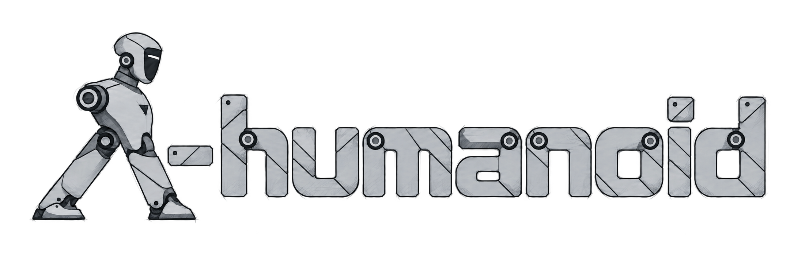
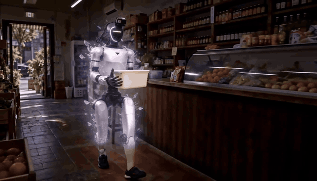

<p align="center">
  <a href="https://github.com/LambdaHumanoid">
    
  </a>
</p>

<h1 align="center">OpenLambda</h1>

<p align="center"><a href="https://github.com/LambdaHumanoid"><strong>Lambda-humanoid Team</strong></a></p>

<p align="center">
  <strong>From human experience to humanoid foundation models.</strong><br>
  Data collection · Human-to-robot alignment · λ₀ training · Inference
</p>

<div align="center">

[](https://lambdahumanoid.github.io/)
[](https://huggingface.co/lambda-humanoid/lambda0-midtrain-100k)
[](LICENSE)

[Abstract](#abstract) · [Demo](#demo) · [Get started](#get-started) · [Model](#model-training) · [Hardware](#hardware-setup) · [Data pipeline](#data-collection) · [Release status](#release-status) · [Citation](#citation)

</div>

<a id="abstract"></a>

## Abstract

Humanoid loco-manipulation requires coordinated whole-body interaction with the physical world, yet collecting robot demonstrations at scale remains costly. Human demonstrations offer a scalable alternative, but existing egocentric human supervision often omits locomotion and posture, while embodiment differences and controller dynamics hinder accurate end-effector execution. We introduce HumanVerse, a 500-hour dataset of open-world human loco-manipulation pairing egocentric video with synchronized body and hand motion. Our human-to-humanoid pipeline aligns camera viewpoints and arm appearance, and refines motion references and controller inputs offline to reduce end-effector errors while preserving whole-body coordination. We validate the pipeline through zero-shot transfer to Unitree G1 on representative whole-body manipulation and long-range loco-manipulation tasks, without target-task robot demonstrations. Building on this pipeline, we develop λ₀, a humanoid foundation model for whole-body loco-manipulation, with robot-aligned human demonstrations providing supervision for mid-training. Increasing whole-body human data consistently improves downstream task progress. λ₀ achieves 90.0% success on SIMPLE and 62.5% across real-world loco-manipulation tasks. We expect this study to guide scalable whole-body human data collection toward humanoid foundation models for richer interaction with the physical world.

<p align="center">
  <a href="https://lambdahumanoid.github.io/#overview">
    
  </a>
</p>

<p align="center"><em>Human data → alignment → three-stage learning → humanoid loco-manipulation.</em></p>

<a id="demo"></a>

## Demo

<p align="center">
  <a href="https://github.com/LambdaHumanoid/openlambda/raw/refs/heads/main/assets/lambda0-demo.mp4">
    
  </a>
</p>

<p align="center">
  Human experience → humanoid loco-manipulation<br>
  <a href="https://github.com/LambdaHumanoid/openlambda/raw/refs/heads/main/assets/lambda0-demo.mp4">Watch the 17-second clip (MP4)</a> · <a href="https://lambdahumanoid.github.io/#report-video">Full project video</a>
</p>

<a id="get-started"></a>

## Get started

> **Available now:** Stage I/II/III model and training code, a [Stage II checkpoint](https://huggingface.co/lambda-humanoid/lambda0-midtrain-100k), and human capture, synchronization, action alignment, and simulation replay tools. The complete post-training and deployment workflows are in preparation; pretraining and mid-training datasets are not included.

Clone the repository, then choose the path that matches your work:

```bash
git clone https://github.com/LambdaHumanoid/openlambda.git
cd openlambda
```

| I want to… | Start here | What is available |
| :--- | :--- | :--- |
| Explore λ₀ | [Install the model package](#lambda0-install) · [Stage II checkpoint](https://huggingface.co/lambda-humanoid/lambda0-midtrain-100k) | Model code, example training configs, environment checks, and an inference server. |
| Capture human demonstrations | [Human hardware](#human-data-collection-hardware) → [Environment](#human-collection-environment) → [Collection](#human-data-collection) | PICO + GoPro recording and motion/video synchronization. |
| Align and replay motion | [Robot runtime environment](#robot-runtime-environment) → [Action alignment](#action-alignment) | Four example trajectories, alignment tools, and before/after simulation replays. |

<a id="model-training"></a>

## λ₀ foundation model

λ₀ learns from human and robot experience in three stages:

| Stage | Supervision | Training objective |
| :--- | :--- | :--- |
| I · Pretraining | Egocentric hand–object datasets | Predict future hand-state tokens with the vision–language backbone. |
| II · Mid-training | Robot-aligned HumanVerse whole-body demonstrations | Introduce the action expert and learn whole-body actions from human experience. |
| III · Post-training | Robot demonstrations | Adapt the policy to downstream tasks and robot execution. |

The [λ₀ package](lambda0/) contains the model, Stage I/II/III training code, data preparation, example configurations, and an inference server. Stage I and II code and configs are provided without a guarantee of end-to-end reproduction. The supported end-to-end release path will be Stage III post-training from the [released Stage-II checkpoint](https://huggingface.co/lambda-humanoid/lambda0-midtrain-100k). The complete post-training workflow is still being prepared.

<a id="lambda0-install"></a>

### Install and run λ₀

From the repository root, use Python 3.11 or 3.12 in a separate environment (the example uses 3.11):

```bash
cd lambda0
python3.11 -m venv .venv
source .venv/bin/activate
python -m pip install -e .
python -m lambda0 doctor
```

The CLI provides `prepare`, `train`, `serve`, and `doctor`. Optional extras are `.[serve]` for the HTTP inference server, `.[tracking]` for WandB, and `.[fast]` for platform-dependent GPU kernels. `lambda0 serve` returns predictions; it does not connect to the robot bridge or send actuator commands.

| Stage | Data selection | Training config |
| :--- | :--- | :--- |
| I · Pretraining | `lambda0/configs/pretrain/data.json` | `lambda0/configs/pretrain/train.json` |
| II · Mid-training | `lambda0/configs/midtrain/data.example.json` | `lambda0/configs/midtrain/train.json` |
| III · Post-training | `lambda0/configs/posttrain/data.example.json` | `lambda0/configs/posttrain/train.json` |

The Stage III example initializes from the raw weights in the [Stage II checkpoint](https://huggingface.co/lambda-humanoid/lambda0-midtrain-100k). Set `STAGE2_CHECKPOINT_DIR` to its downloaded directory.

From the `lambda0/` directory, set paths for the selected stage, then prepare a new data bundle and validate the training configuration before a run:

```bash
python -m lambda0 prepare --source-config configs/pretrain/data.json \
  --data-root "$DATA_ROOT" --output "$BUNDLE_DIR"
python -m lambda0 train --config configs/pretrain/train.json --check-only
```

<details>
<summary><strong>Training data format and current conversion limits</strong></summary>

Stage I expects first-person video and Parquet `observation.state` and `observation.valid_mask` fields, each with 138 coordinates per frame. Stage II and III examples expect canonical `observation.state`, `observation.valid_mask`, `action`, and `action.valid_mask` fields plus aligned video and metadata; the action and state dimensions follow the selected contract in `lambda0/lambda0/models/action_specs.py`. Packaged defaults are in `lambda0/lambda0/recipes/`, while `lambda0/configs/` contains editable examples.

Current human collection writes `observation.pico.*` and `observation.images.gopro`; the action-alignment examples write a 64-dimensional `action.motion_token`. These are not directly usable as λ₀ training episodes. A conversion must combine aligned video, actions, hand targets, proprioception, timestamps, instructions, and validity masks. Stage II uses the 76-dimensional SONIC/Revo2 action contract, so converting human hand motion to Revo2 commands is also required. The examples do not include the paper's pretraining or mid-training datasets, and installation does not verify large-model GPU training or robot deployment.

</details>

<a id="humanverse-500"></a>

### HumanVerse-500

HumanVerse-500 is a 500-hour whole-body human dataset that pairs egocentric video with synchronized body and hand motion across open-world loco-manipulation tasks. Observation and action alignment turn these recordings into robot-compatible supervision for Stage II.

HumanVerse-500 training data is not included in this code release. The four [action-alignment examples](#action-alignment) are available now; they are not the full dataset.

<a id="hardware-setup"></a>

## Hardware setup

<table width="100%">
<tr>
<td width="50%" valign="top">
<a id="human-data-collection-hardware"></a>
<h3>Human Hardware</h3>

<details>
<summary>🔴 <strong>PICO 4 Ultra</strong></summary>

- **Tracking:** [PICO 4 Ultra](https://www.picoxr.com/global/products/pico4-ultra) + trackers<br>for whole-body and hand tracking
- **Software:** XRobo&#8203;Toolkit<br>[Setup&nbsp;guide](https://github.com/NVlabs/GR00T-WholeBodyControl/blob/main/docs/source/getting_started/vr_teleop_setup.md#step-1-install-xrobotoolkit) · [Python&nbsp;SDK](https://github.com/XR-Robotics/XRoboToolkit-PC-Service-Pybind)
- **Connec&#8203;tion:** same LAN as the PC<br>enable Head, Hand and Send

</details>
<br>
<details>
<summary>🔵 <strong>5× PICO Trackers</strong></summary>

- **Placement:** five trackers<br>both wrists, waist and both ankles
- **Calibration:** PICO Motion Tracker<br>pair and calibrate in the app ([guide](https://github.com/NVlabs/GR00T-WholeBodyControl/blob/main/docs/source/getting_started/vr_teleop_setup.md#motion-tracker-calibration))
- **Mode:** Full Body in XRobo&#8203;Toolkit<br>enable Hand tracking ([setup&nbsp;guide](https://github.com/NVlabs/GR00T-WholeBodyControl/blob/main/docs/source/getting_started/vr_teleop_setup.md#step-4-connect-the-pico-to-your-workstation))

</details>
<br>
<details>
<summary>🟠 <strong>GoPro</strong></summary>

- **Mount:** neck-mounted bracket<br>Example: [JD listing](https://item.jd.com/product/5qVT4d95gaChewMJeYVDKQ.html)
- **Alignment:** match height, pitch and framing to the robot camera
- **Connec&#8203;tion:** Bluetooth pairing and WiFi setup;<br>WiFi / COHN recording and download ([API](https://github.com/gopro/OpenGoPro))

</details>
</td>
<td width="50%" valign="top">
<a id="robot-data-collection-hardware"></a>
<h3>Robot Hardware</h3>

<details>
<summary>🟢 <strong>Unitree G1</strong></summary>

- **Platform:** [Unitree G1](https://www.unitree.com/g1/), 29 body DOF<br>excluding hands ([joint&nbsp;layout](https://github.com/unitreerobotics/unitree_rl_gym/blob/main/resources/robots/g1_description/README.md))
- **Control:** [SONIC whole-body controller](https://github.com/NVlabs/GR00T-WholeBodyControl)<br>runs on an external Linux PC
- **Connec&#8203;tion:** wired or WiFi to the PC<br>via the ZMQ bridge

</details>
<br>
<details>
<summary>🔵 <strong>BrainCo Revo2</strong></summary>

- **Hand:** 6 active DOF per hand<br>11 including passive joints ([specs](https://brainco.tech/docs/revolimb-hand/en/revo2/parameters.html))
- **Software:** [official&nbsp;SDK](https://github.com/BrainCoTech/brainco-hand-sdk)<br>hand control and state feedback
- **Mount:** custom G1–Revo2 adapters<br>STL: [part 1](hardware/Revo2-G1-1.stl) · [part 2](hardware/Revo2-G1-2.stl)

</details>
<br>
<details>
<summary>🟠 <strong>GoPro</strong></summary>

- **Mount:** head-mounted bracket<br>STL: [part 1](hardware/G1_GoPro_1.stl) · [part 2](hardware/G1_GoPro_2.stl)
- **Alignment:** match height, pitch and framing to the human camera
- **Connec&#8203;tion:** USB control and video to robot;<br>wired / WiFi forwarding to host ([API](https://github.com/gopro/OpenGoPro))

</details>

</td>
</tr>
</table>

<a id="environment-setup"></a>

## Environment setup

The available tools use separate environments for robot control and action alignment, human data collection, and λ₀ training. Install the [λ₀ package](lambda0/) in its own Python 3.11 or 3.12 environment.

<a id="prerequisites"></a>

<a id="installation"></a>

<a id="robot-runtime-environment"></a>

<details>
<summary>🤖 <strong>Robot Control &amp; Data Collection</strong></summary>

### Host

Ubuntu 22.04 · NVIDIA driver **580+**.

**1. Install dependencies.**

```bash
sudo apt-get update
sudo apt-get install -y --no-install-recommends ca-certificates curl build-essential cmake git git-lfs libgl1 libegl1 libegl-mesa0 libglib2.0-0 ffmpeg libyaml-cpp-dev libeigen3-dev libmsgpack-dev libzmq3-dev nlohmann-json3-dev libssl-dev zlib1g-dev
curl -LsSf https://astral.sh/uv/0.11.14/install.sh | sh
source "$HOME/.local/bin/env"
curl -fL https://developer.download.nvidia.com/compute/cuda/repos/ubuntu2204/x86_64/cuda-keyring_1.1-1_all.deb -o /tmp/cuda-keyring.deb
sudo dpkg -i /tmp/cuda-keyring.deb
sudo apt-get update
sudo apt-get install -y --no-install-recommends cuda-minimal-build-12-4
```

**2. Install TensorRT and ONNX Runtime.** Download `TensorRT-10.13.3.9.Linux.x86_64-gnu.cuda-13.0.tar.gz` from [NVIDIA](https://developer.nvidia.com/tensorrt/download) to the repository root, then run:

```bash
sudo tar -xzf TensorRT-10.13.3.9.Linux.x86_64-gnu.cuda-13.0.tar.gz -C /opt
curl -fL https://github.com/microsoft/onnxruntime/releases/download/v1.16.3/onnxruntime-linux-x64-1.16.3.tgz -o /tmp/onnxruntime.tgz
sudo tar -xzf /tmp/onnxruntime.tgz -C /opt
```

**3. Install environment.** Repeat the exports when opening a new terminal.

```bash
export TensorRT_ROOT=/opt/TensorRT-10.13.3.9
export onnxruntime_ROOT=/opt/onnxruntime-linux-x64-1.16.3
export CUDAToolkit_ROOT=/usr/local/cuda-12.4
export LD_LIBRARY_PATH="$TensorRT_ROOT/lib:$onnxruntime_ROOT/lib:$CUDAToolkit_ROOT/lib64${LD_LIBRARY_PATH:+:$LD_LIBRARY_PATH}"
bash setup/robot/install_host.sh
```

**4. Activate environment.**

```bash
source sonic/.venv/bin/activate
```

### Robot

ARM64 · Ubuntu 20.04 · ROS 2 Foxy · Python 3.8.

**1. Install environment.**

```bash
sudo apt-get update
sudo apt-get install -y python3-dev python3-venv build-essential cmake git python3-colcon-common-extensions ros-foxy-rmw-cyclonedds-cpp ros-foxy-rosidl-generator-dds-idl libyaml-cpp-dev libssl-dev libgl1 libglib2.0-0
bash setup/robot/install_robot.sh
```

**2. Activate environment.**

```bash
source /opt/ros/foxy/setup.bash
source .venv-robot/ros_ws/install/setup.bash
source .venv-robot/bin/activate
```

</details>
<br>
<a id="human-collection-environment"></a>

<details>
<summary>👤 <strong>Human Data Collection</strong></summary>

<p></p>
<p>Ubuntu 22.04 · Python 3.10.</p>

**1. Install environment.**

```bash
sudo apt-get update
sudo apt-get install -y ca-certificates python3.10-dev python3.10-venv build-essential cmake git ffmpeg bluez network-manager
bash setup/human/install.sh
```

**2. Activate environment.**

```bash
source .venv-human/bin/activate
```

</details>
<br>
<a id="policy-environment"></a>

<details>
<summary>🧠 <strong>λ₀ Training & Inference</strong></summary>

See [Install and run λ₀](#lambda0-install) for the package setup and dependency list.

</details>

<a id="data-collection"></a>

## Data collection

<a id="human-data-collection"></a>

### Human data collection

**1. Prepare devices.**

Connect the host and PICO headset to the same network. Start the XRoboToolkit PC service on the host and the XRoboToolkit app on the headset, then enable body and hand tracking. Turn on the GoPro, enable Bluetooth pairing and select Video mode; the collector connects it to the host's WiFi network in the next step.

**2. Start recording.**

```bash
lambda-collect-human --task-name "{task_name}" --task "{task_instruction}"
```

Open `http://127.0.0.1:8080`. Enter the host's WiFi credentials if needed, then click **Prepare collection → Start recording → Save episode / Discard episode**. Wait for saving before recording again. Episodes are saved in LeRobot format to `data/{task_name}/`; new recordings append to the dataset.

**3. Check and synchronize data.**

```bash
lambda-sync-human --root "data/{task_name}"
```

Checks the recordings, synchronizes motion and video at 50 Hz, then checks the output. Results are saved to `data/{task_name}_synced/`, with synchronization and data quality reports in `meta/`.

<a id="robot-data-collection"></a>

### Robot data collection

**TODO:** Release an episode-based recorder for the G1, SONIC controller, Revo2 hands, and head camera. The existing robot state bridge and camera relay provide runtime signals, but they do not yet form a reproducible data-collection workflow. The recorder still needs synchronized video, robot state, commanded actions, task instructions, timestamps, and episode boundaries, followed by checks for dropped frames and incomplete episodes.

<a id="data-processing"></a>
<a id="data-alignment"></a>

## Data alignment

<a id="action-alignment"></a>

### Action alignment

We provide one example trajectory for each of the four tasks in [examples](data_alignment/action_alignment/examples). Data, reports, and videos are also available in the [release](https://github.com/LambdaHumanoid/openlambda/releases/tag/v0.1.1). The simulation replays below compare these trajectories before (left) and after (right) alignment.

<table>
<tr>
<td width="50%">

https://github.com/user-attachments/assets/c4b43c5d-199a-447b-b0a3-afe6afe76d3e

</td>
<td width="50%">

https://github.com/user-attachments/assets/a7d8f8d4-a22a-40b6-816a-bf562f691720

</td>
</tr>
<tr>
<td width="50%">

https://github.com/user-attachments/assets/403659cc-2f87-4d60-bf84-14bf831a65d7

</td>
<td width="50%">

https://github.com/user-attachments/assets/71c1de99-8f2e-4ee1-875c-fe4be36db618

</td>
</tr>
</table>

**1. Align motion.**

The pipeline performs **human-reference alignment**, **robot-reference alignment**, and **dynamics-aware optimization**. For hand tasks, **H** first corrects SMPL collar, shoulder, and elbow poses using a uniformly scaled virtual body while preserving the original end-effector targets. Foot tasks encode the input SMPL directly without this correction; **K** and **D** retain their joint-space and motion-token optimization.

Place the input recording at `{task_name}/input.parquet`. Set `{endpoints}` to `hands` for hand alignment or `feet` for foot alignment.

```bash
lambda-align \
  --input "{task_name}/input.parquet" \
  --endpoints {endpoints} \
  --output "results/{task_name}"
```

Results are saved under `results/{task_name}/`: `data.parquet` contains the original human SMPL motion and aligned tokens; `run.json` records per-round metrics and the selected round.

**2. Replay motion.**

**SMPL replay:** encode the original human motion online, without human-reference correction, to simulate before alignment.

```bash
lambda-replay \
  --input "{task_name}/data.parquet" \
  --mode smpl \
  --output "results/{task_name}/before"
```

**Token replay:** replay the aligned motion tokens to simulate after alignment.

```bash
lambda-replay \
  --input "{task_name}/data.parquet" \
  --mode token \
  --output "results/{task_name}/after"
```

Each command saves `replay.mp4` in its output directory. Results may vary slightly between runs.

<a id="vision-alignment"></a>

### Vision alignment

Coming soon.

<a id="data-conversion"></a>

## Data conversion

**TODO:** Release converters from synchronized human recordings and robot demonstrations to the canonical λ₀ episode format. The human path needs to combine aligned video, hand targets, whole-body actions, and proprioception. The robot path needs to align camera frames, robot state, and action signals, and define which signals become post-training targets. Both paths need task text, timestamps, validity masks, dataset metadata, and validation against the selected action and coordinate contracts. The existing `lambda0 prepare` command bundles episodes that already follow this format; it does not perform these source-data conversions.

<a id="deployment"></a>

## Evaluation & deployment

At deployment, λ₀ takes robot camera observations, language instructions, and proprioceptive state. It predicts SONIC motion tokens and Revo2 hand commands without a human motion stream.

The [λ₀ package](lambda0/) includes an inference server that returns predictions without sending robot commands. Simulation evaluation and real-robot deployment instructions are still being prepared. For the available motion-level simulation tools, see [Action Alignment](#action-alignment).

<a id="todo"></a>
<a id="workflow--release-checklist"></a>
<a id="release-status"></a>

## Release status

| Component | Available now | Pending / not included |
| :--- | :--- | :--- |
| Hardware & environments | [Human and robot setup](#hardware-setup); [runtime environments](#environment-setup); [λ₀ environment](#lambda0-install) | — |
| Data collection | [Human capture and synchronization](#human-data-collection) | [Robot episode recorder](#robot-data-collection) |
| Data alignment | [Action alignment and simulation examples](#action-alignment) | [Vision alignment](#vision-alignment) |
| Data conversion | `lambda0 prepare` bundles already-canonical episodes | [Human/robot recording converters](#data-conversion) |
| HumanVerse-500 | [Dataset overview](#humanverse-500); four alignment examples | Training data is not included in this release. |
| λ₀ model | [Stage I/II/III code and configs](#model-training); [Stage II checkpoint](https://huggingface.co/lambda-humanoid/lambda0-midtrain-100k) | Complete Stage III post-training workflow |
| Evaluation & deployment | [Motion replay](#action-alignment); prediction server | [Policy evaluation and real-robot deployment](#deployment) |

<a id="citation"></a>

## Citation

If you find this repository useful in your research, please consider citing the relevant works below.

<details open>
<summary><strong>λ₀ · Scaling open-world egocentric human data (Lambda-humanoid Team)</strong></summary>

```bibtex
@misc{lambdahumanoidteam2026lambda0scalingopenworldegocentric,
      title={$\lambda_0$: Scaling Open-World Egocentric Human Data for Humanoid Loco-Manipulation},
      author={{Lambda-humanoid Team}},
      year={2026},
      eprint={2610.18950},
      archivePrefix={arXiv},
      primaryClass={cs.RO},
      url={https://arxiv.org/abs/2610.18950},
}
```

</details>

<details>
<summary><strong>Related work · Egocentric whole-body human data pretraining</strong></summary>

```bibtex
@article{xu2026generalhumanoidlocomanipulationmodel,
  title={Towards a General Humanoid Loco-Manipulation Model via Egocentric Whole-Body Human Data Pretraining},
  author={Xu, Chongyang and Wu, Zhao and Chen, Jin and Jiang, Yiming and Ye, Jinhui and Jiang, Yuming and Zhang, Shifeng and Feng, Ziliang and Xu, Mu and Chen, Yilun and Lu, Li and Hoi, Steven C. H.},
  journal={arXiv preprint arXiv:2610.00438},
  year={2026}
}
```

</details>

<details>
<summary><strong>EgoHumanoid-V2 · Coordinated whole-body skills</strong></summary>

```bibtex
@article{chen2026egohumanoidv2,
  title={{EgoHumanoid-V2}: Human-to-Humanoid Transfer of Coordinated Whole-Body Skills for Loco-Manipulation},
  author={Chen, Jin and Jiang, Yiming and Xu, Chongyang and Shi, Modi and Peng, Shijia and Chen, Li and Li, Tianyu and Xu, Mu and Chen, Yilun and Hoi, Steven and Li, Hongyang},
  journal={arXiv preprint arXiv:2609.37181},
  year={2026}
}
```

</details>

<details>
<summary><strong>EgoAlign · Long-range loco-manipulation</strong></summary>

```bibtex
@article{jiang2026egoalign,
  title={{EgoAlign}: Bridging the Human-Humanoid Gap for Long-Range Loco-Manipulation},
  author={Jiang, Yiming and Chen, Jin and Xu, Chongyang and Chen, Yilun and Hao, Aimin and He, Yisheng},
  journal={arXiv preprint arXiv:2609.38046},
  year={2026}
}
```

</details>


---

<a id="acknowledgments"></a>

## Acknowledgments

We thank X-VLA, StarVLA, SONIC, XRoboToolkit, and Open GoPro for sharing their work with the community.

Source and asset attributions are retained in [NOTICE](NOTICE).

| [](https://github.com/2toinf/X-VLA) | [](https://github.com/starVLA/starVLA) | [](https://github.com/NVlabs/GR00T-WholeBodyControl) | [](https://github.com/XR-Robotics/XRoboToolkit-Unity-Client) | [](https://github.com/gopro/OpenGoPro) |
| :---: | :---: | :---: | :---: | :---: |
| Cross-embodiment&nbsp;VLA | VLA&nbsp;models | Whole-body&nbsp;control | PICO&nbsp;tracking | GoPro&nbsp;interface |
