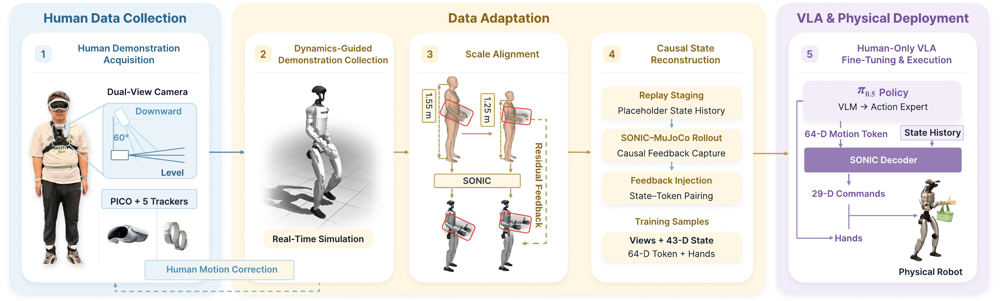

<div align="center">
  <picture>
    <source media="(prefers-color-scheme: dark)" srcset="assets/figures/title_dark.svg">
    
  </picture>
  <p>
    <a href="https://iridescentjiang.github.io/">Yiming Jiang</a><sup>1,4,*</sup> &nbsp;·&nbsp;
    <a href="https://scholar.google.com/citations?user=4FqHXOsAAAAJ">Jin Chen</a><sup>2,4</sup> &nbsp;·&nbsp;
    <a href="https://chongyang-99.github.io/">Chongyang Xu</a><sup>3,4</sup> &nbsp;·&nbsp;
    <a href="https://yilunchen.com/about/">Yilun Chen</a><sup>4,†</sup> &nbsp;·&nbsp;
    <a href="https://research.buaa.edu.cn/en/persons/aimin-hao/">Aimin Hao</a><sup>1,‡</sup> &nbsp;·&nbsp;
    <a href="https://hyshkust.github.io/">Yisheng He</a><sup>4,†,‡</sup>
  </p>
  <p>
    <sup>1</sup> Beihang University &nbsp;·&nbsp;
    <sup>2</sup> Shanghai Innovation Institute<br>
    <sup>3</sup> Sichuan University &nbsp;·&nbsp;
    <sup>4</sup> Alibaba Group
  </p>
  <p>
    <sup>*</sup> Work done during an internship at Alibaba Token Hub (ATH), Alibaba Group.<br>
    <sup>†</sup> Co-project leaders &nbsp;·&nbsp; <sup>‡</sup> Co-corresponding authors.
  </p>
  <p>
    <a href="https://lambdahumanoid.github.io/EgoAlign/"></a>
    <a href="https://arxiv.org/abs/2609.38046"></a>
  </p>
  <p><a href="README.md">English</a> · <a href="README_zh.md">简体中文</a></p>
</div>

<p align="center">
  <strong>对齐人类示范，实现人形机器人的零样本长距离移动操作。</strong>
</p>

**EgoAlign** 面向**长距离移动操作任务**，让机器人从第一视角人类示范中学习。通过尺度对齐与控制器闭环优化生成状态—动作监督，训练可零样本部署到 Unitree G1 的 VLA 策略，无需目标任务的真机示范。

## 🔄 方法流程



将人体示范适配到机器人，通过仿真闭环优化，再生成配对的状态—动作监督，用于 VLA 微调。

## ⭐ 核心特点

- **仅用人类示范**学习长距离移动操作。
- **尺度对齐与仿真优化**实现跨形态迁移。
- **因果回放**生成配对的机器人状态与 motion token。
- **通过 SONIC 全身控制**零样本部署到 G1。

## 🚀 功能与路线图

将兼容格式的人体示范转化为 **G1 机器人学习数据**：

- [x] 双手掌心对齐与 SONIC–MuJoCo 回放残差优化。
- [x] 带控制器历史状态的因果回放，生成配对状态与 motion token。
- [x] 物体转运样例、可视化与末端精度评估。
- [x] 更多任务的对比视频。

选择 `endpoint-align` 进行对齐与迭代，或选择 `replay-only` 直接进行因果回放。两种模式均导出配对的 **43D state**、**64D motion token** 和双手各 6D 指令（合计 **76D action**），供下游 VLA 训练使用。命令见[处理指南](docs/PROCESSING.md)。

我们可能会在后续公开 VLA 训练方案。目前可参考 [OpenPI](https://github.com/Physical-Intelligence/openpi) 进行 VLA 训练。

## 🛠️ 安装

`main` 分支存放开源代码和技术文档；[项目网站](https://lambdahumanoid.github.io/EgoAlign/)
单独维护在 `gh-pages` 分支的 `docs/` 目录。

使用 Python 3.10，先阅读[依赖说明](docs/DEPENDENCIES.md)。在代码目录执行：

```bash
python -m venv .venv
source .venv/bin/activate
pip install -e '.[test,simulation,data]'

python -m egoalign endpoint-align --help
python -m egoalign replay-only --help
```

随后配置仿真环境：Stage A/C 需要兼容的 LeRobot 和 Pinocchio；CUDA PyTorch 需匹配运行环境。

按[公开 SONIC 运行时与补丁指南](docs/public_runtime.md)配置仿真，支持原生环境或在用户自备的 GPU 容器内运行启动器。SMPL、BrainCo 模型资产和控制器权重的获取、路径与检查方式见[外部资产配置](docs/EXTERNAL_ASSETS.md)。

已使用现有依赖完成新控制器编译和端到端处理验证，详情见[验证记录](docs/VALIDATION.md)。

## 📦 长距离移动操作样例

以[物体转运](examples/data/basket/)展示长距离移动与物体操作的结合。视频从左到右展示真实物理尺度的 SMPL、对齐前 G1 和对齐后 G1。

<table align="center" width="67%">
  <tr><td colspan="3" align="center">

https://github.com/user-attachments/assets/3129a65a-8715-4151-a03d-8384ddb4d9a1

  </td></tr>
  <tr>
    <td align="center" width="33%" nowrap>双掌平均误差 ↓</td>
    <td align="center" width="33%" nowrap>对齐前: 15.13 cm</td>
    <td align="center" width="33%" nowrap>对齐后: <strong>1.41 cm</strong></td>
  </tr>
</table>

完成[运行时配置](docs/public_runtime.md)后，预览处理命令：

```bash
"$EGOALIGN_DATA_PYTHON" -m egoalign.sample_pipeline basket \
  --raw-root examples/data/basket \
  --robot-xml "$EGOALIGN_RUNTIME_ROOT/gear_sonic/data/robot_model/model_data/g1/g1_29dof_with_hand.xml" \
  --output-root /path/to/new/basket-result --dry-run
```

检查命令后，按[样例指南](examples/README.md)运行处理流程并导出回放视频。

<!-- additional-examples:start -->

## 🎬 更多长距离移动操作任务

从左到右：真实物理尺度的 SMPL、对齐前 G1、对齐后 G1（Round 2）。

### 将收纳盒放到桌子上

---

<table align="center" width="67%">
  <tr><td colspan="3" align="center">

https://github.com/user-attachments/assets/50d807a1-633c-4e5e-ac26-31af12d567a2

  </td></tr>
  <tr>
    <td align="center" width="33%" nowrap>双掌平均误差 ↓</td>
    <td align="center" width="33%" nowrap>对齐前: 9.22 cm</td>
    <td align="center" width="33%" nowrap>对齐后: <strong>1.47 cm</strong></td>
  </tr>
</table>

### 货架操作

---

<table align="center" width="67%">
  <tr><td colspan="3" align="center">

https://github.com/user-attachments/assets/71dfa4c2-544c-4625-b2d2-8b13f361d30a

  </td></tr>
  <tr>
    <td align="center" width="33%" nowrap>双掌平均误差 ↓</td>
    <td align="center" width="33%" nowrap>对齐前: 12.00 cm</td>
    <td align="center" width="33%" nowrap>对齐后: <strong>2.15 cm</strong></td>
  </tr>
</table>

### 取快递并送到房间

---

<table align="center" width="67%">
  <tr><td colspan="3" align="center">

https://github.com/user-attachments/assets/edc0d6e7-979d-4917-bff6-0a12ba669ecc

  </td></tr>
  <tr>
    <td align="center" width="33%" nowrap>双掌平均误差 ↓</td>
    <td align="center" width="33%" nowrap>对齐前: 14.44 cm</td>
    <td align="center" width="33%" nowrap>对齐后: <strong>3.42 cm</strong></td>
  </tr>
</table>

### 室内保洁

---

<table align="center" width="67%">
  <tr><td colspan="3" align="center">

https://github.com/user-attachments/assets/198caafd-7a0f-48e2-b434-868fee009aa2

  </td></tr>
  <tr>
    <td align="center" width="33%" nowrap>双掌平均误差 ↓</td>
    <td align="center" width="33%" nowrap>对齐前: 13.18 cm</td>
    <td align="center" width="33%" nowrap>对齐后: <strong>3.63 cm</strong></td>
  </tr>
</table>

### 统计口径

---

视频保留真实尺度与相对地面的运动；人体手指按对齐后机器人的同一抓握指令展示。

所有结果统一采用 **0.24 s 时延补偿**。

| 项目 | 定义 |
|---|---|
| 误差 | 双掌所有有效帧的欧氏距离均值，越低越好 |
| 时间配对 | 50 Hz 下，目标第 i 帧对应机器人第 i+12 帧；舍去末尾 12 个目标帧 |
| 坐标系 | XY 以骨盆为中心，Z 以较低脚部为基准 |
| 视频时序 | 保持原始时间，不做时延补偿 |

完整精度与质量检查见[指标记录](assets/metrics/media_manifest.json)。

<!-- additional-examples:end -->

## 📁 代码结构

`assets/` 存放 README 使用的论文流程图、对比视频及指标记录。

```text
egoalign/             命令入口与流水线编排
  geometry/          坐标与旋转计算
  robots/g1/         G1 模型、关节定义与 BrainCo 手部映射
  datasets/          数据字段、导出与视频写入
  adapters/sonic/    SONIC 状态、回放生命周期与遥测契约
scripts/human_data/   末端对齐、残差迭代与数据导出
runtime/             公开运行时补丁与来源清单
configs/             依赖版本与资产哈希
examples/            物体转运输入和复现说明
tools/               运行时配置、回放适配与验证工具
  run_sim_replay.sh  由数据处理流程调用的仿真回放适配器
tests/               自动化测试
docs/                处理流程、运行环境、数据契约与验证指南
```

SONIC 控制器与 MuJoCo 回放程序按照[运行时指南](docs/public_runtime.md)单独安装。
本地适配模块保存与它们交互的数据接口；几何计算、机器人模型和数据工具分别组织。
处理流程通过 `tools/run_sim_replay.sh` 将回放请求转交给 `EGOALIGN_REPLAY_DRIVER`。
按运行时指南完成配置后，使用上面的 Python 命令即可，无需直接执行这个适配脚本。

## 📘 文档与检查

- [处理流程与完整命令](docs/PROCESSING.md)
- [输入输出数据契约](docs/DATA_CONTRACT.md)
- [SONIC–MuJoCo 安装与补丁](docs/public_runtime.md)
- [外部资产](docs/EXTERNAL_ASSETS.md)与[依赖版本](docs/DEPENDENCIES.md)
- [样例复现与验证](examples/README.md)
- [验证结果](docs/VALIDATION.md)
- [第三方组件与条款](docs/THIRD_PARTY.md)

开发检查：

```bash
python -m pytest -q
python tools/check_cli.py
python tools/audit_source.py
```

## 📚 引用

如果本项目对你的研究有帮助，请引用：

```bibtex
@misc{jiang2026egoalign,
  title = {{EgoAlign}: Bridging the Human-Humanoid Gap for Long-Range Loco-Manipulation},
  author = {Yiming Jiang and Jin Chen and Chongyang Xu and
            Yilun Chen and Aimin Hao and Yisheng He},
  year = {2026},
  eprint = {2609.38046},
  archivePrefix = {arXiv},
  primaryClass = {cs.RO},
  url = {https://arxiv.org/abs/2609.38046}
}
```

## 🙏 致谢

感谢以下开源项目及其团队：

| [](https://github.com/Physical-Intelligence/openpi) | [](https://github.com/NVlabs/GR00T-WholeBodyControl) | [](https://github.com/XR-Robotics/XRoboToolkit-Unity-Client) | [](https://github.com/gopro/OpenGoPro) |
| :---: | :---: | :---: | :---: |
| VLA&nbsp;模型 | 全身控制 | PICO&nbsp;追踪 | GoPro&nbsp;接口 |

